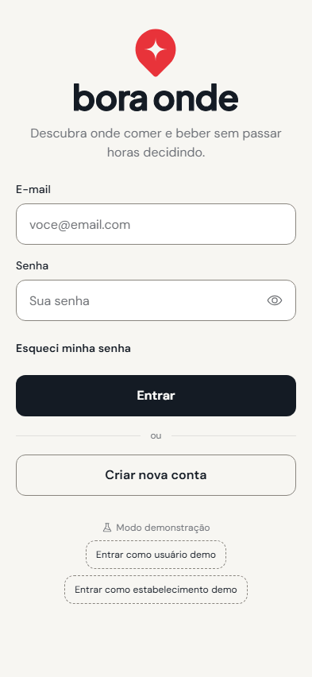

# Bora Onde

Na dúvida de onde ir comer ou beber? O **Bora Onde** mostra restaurantes, cafeterias e bares da sua cidade e, depois
de 3 perguntas rápidas, indica o lugar certo para o seu momento.

</br>

<p align="center"></p>

</br>

## O que dá para fazer

**Como usuário**
- Criar uma conta e ver os lugares da sua cidade, em um feed com fotos.
- Filtrar por tipo (restaurante, cafeteria, bar), ambiente e venda de bebida alcoólica.
- Responder ao questionário e receber uma indicação. Se não gostar, é só pedir outra.
- Trocar a cidade do perfil, sair ou excluir a conta.

**Como estabelecimento**
- Cadastrar o local com fotos e endereço.
- Ver como o seu lugar aparece no feed.
- Dizer qual é o tipo, o ambiente e se vende bebida alcoólica. É isso que decide quando o local é indicado.
- Editar fotos e dados, ou excluir a conta.

**Como a indicação escolhe o lugar**
1. Só entram lugares do tipo escolhido e, se você precisa de bebida alcoólica, que vendam.
2. Quem combina com a vibe (familiar, com amigos ou romântico) aparece primeiro.
3. Em caso de empate, vale a ordem alfabética.

## Stack

- **Expo SDK 57** + Expo Router + TypeScript (compatível com o Expo Go da App Store)
- **NativeWind 4** (Tailwind 3), com os tokens do Figma em um único `tokens.json`
- **Supabase**: Postgres, Auth e Storage, com **Row Level Security**
- TanStack Query, React Hook Form + Zod, expo-image / expo-image-picker, Phosphor Icons
- Jest (motor de indicação e filtros)

## Rodar o projeto

```bash
npm install
```

### 1. Configurar o Supabase (uma vez)

1. Crie um projeto gratuito em [supabase.com](https://supabase.com).
2. **Authentication → Providers → Email**: desligue **"Confirm email"** (senão o cadastro exige clicar em um link).
3. **SQL Editor**: cole e execute [`supabase/migrations/0001_init.sql`](supabase/migrations/0001_init.sql)
   (tabelas, RLS, trigger de cadastro, bucket `place-photos` e `delete_my_account`; é idempotente).
4. Crie o `.env` a partir do `.env.example` com a URL e a chave pública (**Connect** ou *Settings → API Keys*):

   ```
   EXPO_PUBLIC_SUPABASE_URL=https://SEU-PROJETO.supabase.co
   EXPO_PUBLIC_SUPABASE_KEY=sb_publishable_...   # ou a anon key legada
   ```

5. Crie o `.env.seed` a partir do `.env.seed.example` com a **secret key** (`sb_secret_…` ou `service_role`).
   Ela ignora o RLS: fica só na sua máquina, nunca no app nem no Git.
6. Popule a demonstração e confira as regras de acesso:

   ```bash
   npm run seed        # contas demo, 12 lugares em 3 cidades e 45 fotos (idempotente)
   npm run check:rls   # tenta, com contas reais, o que o RLS deve bloquear
   ```

### 2. Abrir o app

```bash
npx expo start
```

Escaneie o QR code com o **Expo Go** (celular na mesma rede Wi-Fi) ou pressione `w` para a versão web.

**Contas demo** (senha `demo12345`): `ana@boraonde.demo` (usuário, Brasília) e `bardoze@boraonde.demo`
(dono do Bar do Zé). A tela de login tem os atalhos "Entrar como … demo".

Para ver o UI Kit: rotas ocultas `/dev/kit` (tokens) e `/dev/components` (componentes e estados).

## Scripts

| Comando | O que faz |
|---|---|
| `npm test` | Testes unitários (motor de indicação e filtros) |
| `npm run seed` | Recria a demonstração no Supabase |
| `npm run check:rls` | Verifica as políticas de segurança com contas reais |
| `npx tsc --noEmit` / `npx expo lint` | Tipos e lint |

## Estrutura

```
src/app/            rotas (Expo Router): (auth), (user), (establishment), dev
src/components/ui/  UI Kit (botão, campos, chips, seletores, card, barra de abas, toast, modais…)
src/features/       auth, feed, recommendation, establishment, profile
src/data/           cliente Supabase, APIs de lugares e storage, tipos
src/theme/          tokens do Figma (tokens.json é a fonte única: Tailwind + TypeScript)
supabase/           migration SQL e fotos de seed (com CREDITS.md)
scripts/            seed.mjs e check-rls.mjs
```

## Notas

- **"Esqueci minha senha" é só visual.** Ele mostra a mensagem de envio, mas não manda e-mail de verdade.
- **O Supabase gratuito pausa projetos parados.** Se isso acontecer, é só reativar no painel. O arquivo
  `.github/workflows/supabase-keepalive.yml` evita a pausa, mas só funciona depois de cadastrar `SUPABASE_URL` e
  `SUPABASE_KEY` nos *secrets* do repositório.
- **Versão do Expo.** O projeto usa o SDK 57, que é o que o Expo Go da App Store aceitava quando foi feito.
- **Trocou uma foto de exemplo?** Rode `npm run seed` de novo. Os nomes das fotos mudam junto com a imagem, para o app
  não continuar mostrando a antiga.
