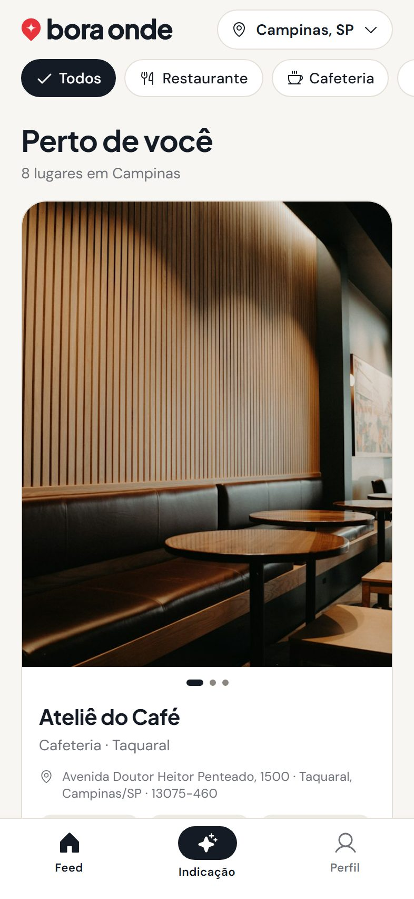
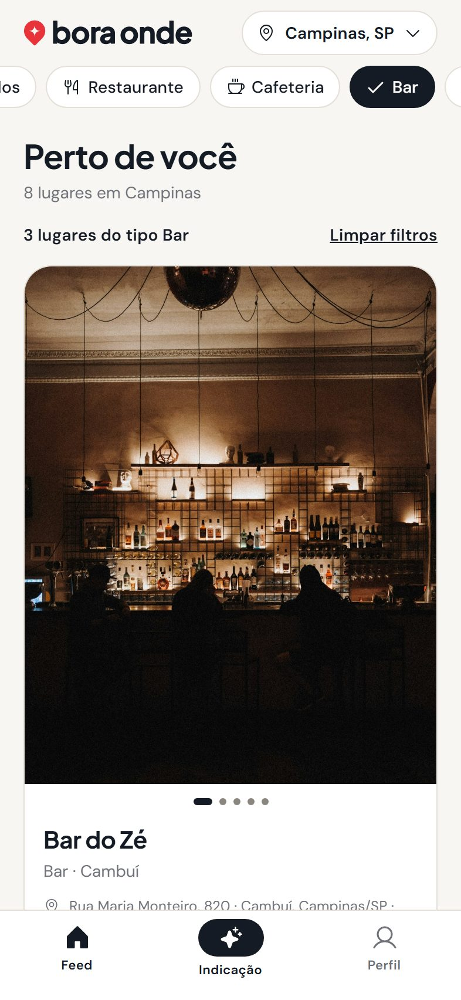
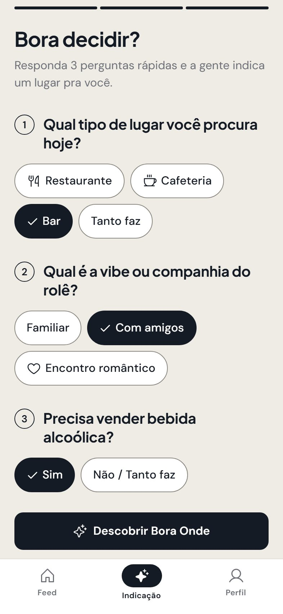
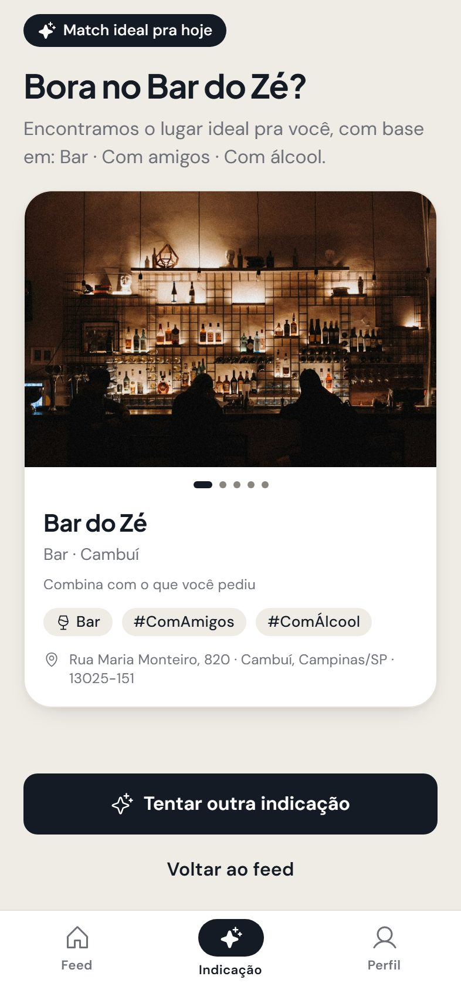
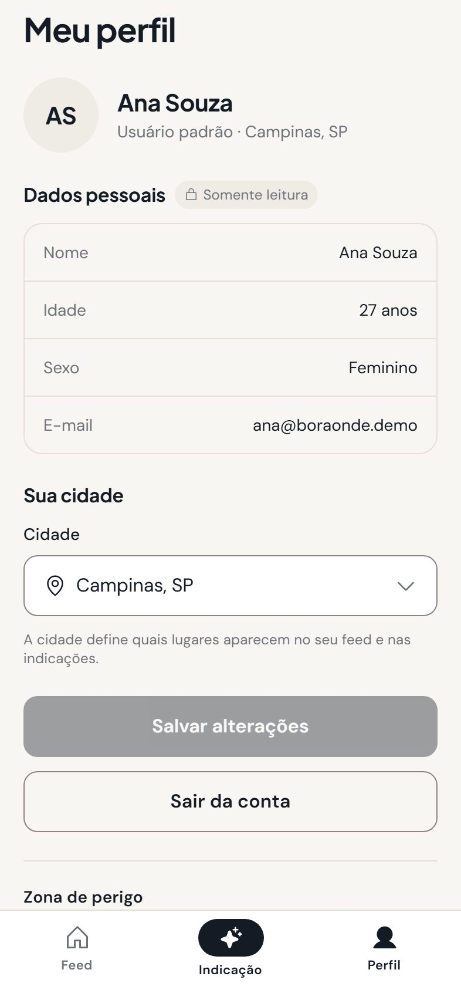
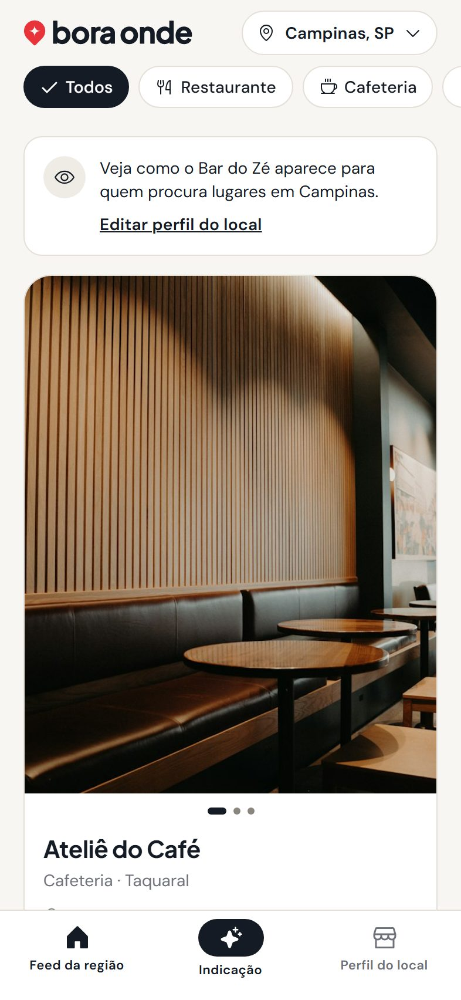
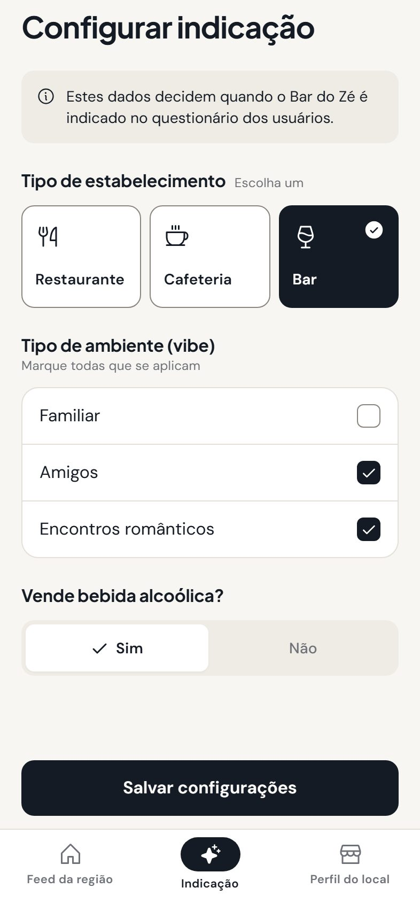
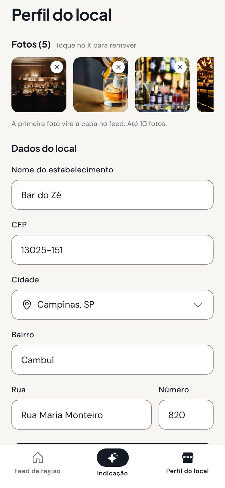
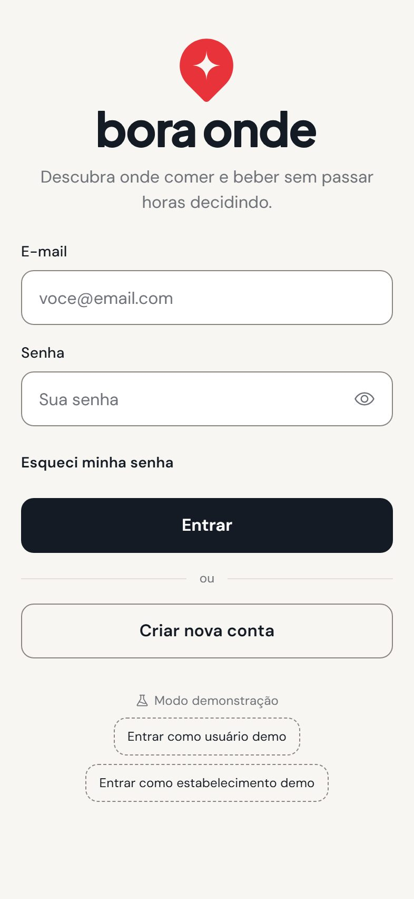

# Bora Onde

App mobile que resolve a pergunta "**bora onde?**": centraliza restaurantes, cafeterias e bares em um feed por cidade
(estilo Instagram) e, com um **Questionário de Indicação** de 3 perguntas, recomenda o lugar certo para o momento.
Projeto de portfólio — os estabelecimentos são fictícios.

<p align="center"></p>

| Feed da cidade | Filtro rápido | Questionário |
|---|---|---|
|  |  |  |
| **Indicação** | **Perfil do usuário** | **Feed do estabelecimento** |
|  |  |  |
| **Dados para indicação** | **Perfil do local** | **Login** |
|  |  |  |

## O que o app faz

**Dois perfis de conta**

- **Usuário padrão** — cadastra-se (nome, idade, sexo, cidade), navega pelo feed da sua cidade, filtra por tipo,
  ambiente e venda de álcool, responde ao questionário e recebe uma indicação ("Tentar outra" mostra o próximo
  candidato). Só a cidade é editável; pode sair ou excluir a conta.
- **Estabelecimento** — cadastra o local com fotos e endereço, vê o feed da região (com um aviso de como o próprio
  lugar aparece), define **tipo, ambiente e venda de álcool** (os "Dados extras" que alimentam as indicações),
  gerencia fotos e dados, e pode excluir a conta (apaga lugar, fotos e login).

**Como a indicação funciona** (`src/features/recommendation/engine.ts`, função pura com testes):

1. *Filtros duros*: tipo de lugar (se não for "tanto faz") e venda de álcool (se for requisito).
2. *Critério suave*: quem atende à vibe escolhida (familiar, com amigos, romântico) vem primeiro.
3. Empate pelo nome — o resultado é determinístico. "Tentar outra indicação" acumula os já mostrados; sem mais
   candidatos o botão vira "Refazer o questionário". Lugares sem Dados extras não entram.

## Stack

- **Expo SDK 57** + Expo Router + TypeScript (compatível com o Expo Go da App Store)
- **NativeWind 4** (Tailwind 3), com os tokens do Figma em um único `tokens.json`
- **Supabase**: Postgres, Auth e Storage, com **Row Level Security**
- TanStack Query, React Hook Form + Zod, expo-image / expo-image-picker, Phosphor Icons
- Jest (motor de indicação e filtros)

## Decisões de arquitetura

- **RLS como fronteira de segurança.** O papel (usuário/estabelecimento) vem do cadastro e só escolhe o fluxo de
  telas; o banco decide o que cada um lê e escreve. Dados pessoais são somente leitura (`grant update (city)`),
  cada dono só altera o próprio lugar e só escreve na própria pasta do Storage. `npm run check:rls` prova isso com
  contas reais.
- **Perfil criado por trigger** a partir dos metadados do cadastro — atômico, sem corrida entre sessão e perfil.
- **Exclusão de conta** por função `security definer` (`delete_my_account`) com `on delete cascade`; o app apaga
  antes as fotos do Storage.
- **Motor de indicação no cliente**, como função pura: com poucas dezenas de lugares por cidade, uma RPC só
  complicaria. Fica fácil de testar.
- **"Esqueci minha senha" é só interface** (decisão de escopo): valida o e-mail e mostra o modal do protótipo, sem
  enviar nada e sem revelar se a conta existe. Um fluxo real exigiria deep link e uma tela de nova senha.
- **Design fiel ao Figma**: tokens (cores, tipografia, raios, sombras) extraídos do arquivo; telas e estados que o
  Figma não desenha (vazio, erro, carregando, painéis de seleção) foram criados com os mesmos componentes.

## Rodar o projeto

```bash
npm install
```

### 1. Configurar o Supabase (uma vez)

1. Crie um projeto gratuito em [supabase.com](https://supabase.com).
2. **Authentication → Providers → Email**: desligue **"Confirm email"** (senão o cadastro exige clicar em um link).
3. **SQL Editor**: cole e execute [`supabase/migrations/0001_init.sql`](supabase/migrations/0001_init.sql)
   (tabelas, RLS, trigger de cadastro, bucket `place-photos` e `delete_my_account`; é idempotente).
4. Crie o `.env` a partir do `.env.example` com a URL e a chave pública (**Connect** ou *Settings → API Keys*):

   ```
   EXPO_PUBLIC_SUPABASE_URL=https://SEU-PROJETO.supabase.co
   EXPO_PUBLIC_SUPABASE_KEY=sb_publishable_...   # ou a anon key legada
   ```

5. Crie o `.env.seed` a partir do `.env.seed.example` com a **secret key** (`sb_secret_…` ou `service_role`).
   Ela ignora o RLS: fica só na sua máquina, nunca no app nem no Git.
6. Popule a demonstração e confira as regras de acesso:

   ```bash
   npm run seed        # contas demo, 12 lugares em 3 cidades e 45 fotos (idempotente)
   npm run check:rls   # tenta, com contas reais, o que o RLS deve bloquear
   ```

### 2. Abrir o app

```bash
npx expo start
```

Escaneie o QR code com o **Expo Go** (celular na mesma rede Wi-Fi) ou pressione `w` para a versão web.

**Contas demo** (senha `demo12345`): `ana@boraonde.demo` (usuário, Campinas) e `bardoze@boraonde.demo`
(dono do Bar do Zé). A tela de login tem os atalhos "Entrar como … demo".

Para ver o UI Kit: rotas ocultas `/dev/kit` (tokens) e `/dev/components` (componentes e estados).

## Scripts

| Comando | O que faz |
|---|---|
| `npm test` | Testes unitários (motor de indicação e filtros) |
| `npm run seed` | Recria a demonstração no Supabase |
| `npm run check:rls` | Verifica as políticas de segurança com contas reais |
| `npx tsc --noEmit` / `npx expo lint` | Tipos e lint |

## Estrutura

```
src/app/            rotas (Expo Router): (auth), (user), (establishment), dev
src/components/ui/  UI Kit (botão, campos, chips, seletores, card, barra de abas, toast, modais…)
src/features/       auth, feed, recommendation, establishment, profile
src/data/           cliente Supabase, APIs de lugares e storage, tipos
src/theme/          tokens do Figma (tokens.json é a fonte única: Tailwind + TypeScript)
supabase/           migration SQL e fotos de seed (com CREDITS.md)
scripts/            seed.mjs e check-rls.mjs
```

## Notas

- **Plano gratuito do Supabase**: projetos sem uso por cerca de uma semana são pausados (restaure no painel; os dados
  ficam). O workflow `.github/workflows/supabase-keepalive.yml` faz uma consulta leve a cada 3 dias — basta
  cadastrar os secrets `SUPABASE_URL` e `SUPABASE_KEY` no repositório.
- **Cache de imagens**: as fotos do seed são enviadas com o hash do conteúdo no nome
  (`seed/bar-do-ze-1-a1b2c3d4.jpg`). O `expo-image` guarda imagens em disco *pela URL*; trocar a foto no mesmo caminho
  deixaria o app mostrando a antiga. Com o hash, a URL muda junto com a foto. O `npm run seed` remove os arquivos
  antigos do bucket.
- **Expo Go**: o projeto usa o SDK 57 porque é o que o Expo Go da App Store suportava ao desenvolvê-lo.
- **Ícones**: o `phosphor-react-native` entra inteiro no bundle (módulos carregados sob demanda); trocar por imports
  individuais foi avaliado e não compensou neste escopo.

## Créditos

Fotos de demonstração de [Unsplash](https://unsplash.com/license) e [Pexels](https://www.pexels.com/license/),
de uso gratuito — lista completa de fotógrafos em [`supabase/seed-assets/CREDITS.md`](supabase/seed-assets/CREDITS.md).
Design, logotipo e UI Kit: arquivo Figma do projeto (wireframe e protótipo de alta fidelidade).
